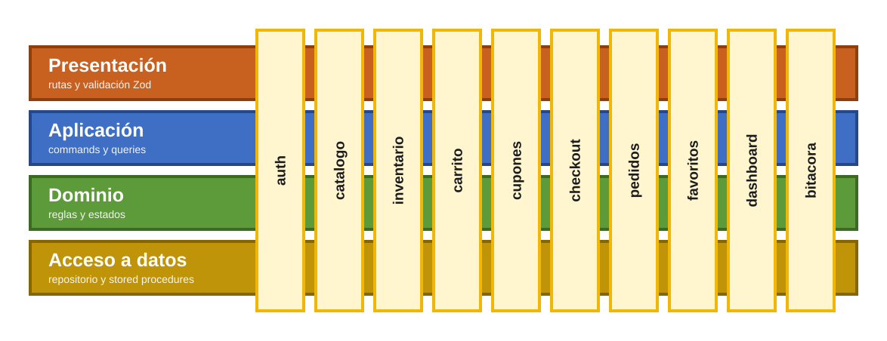
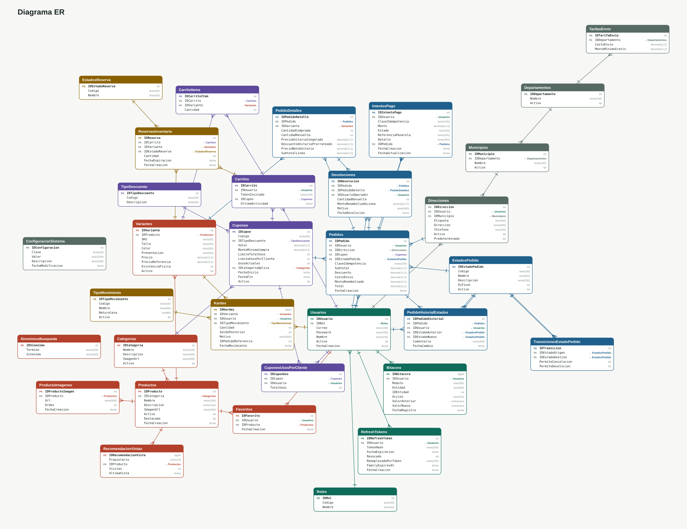
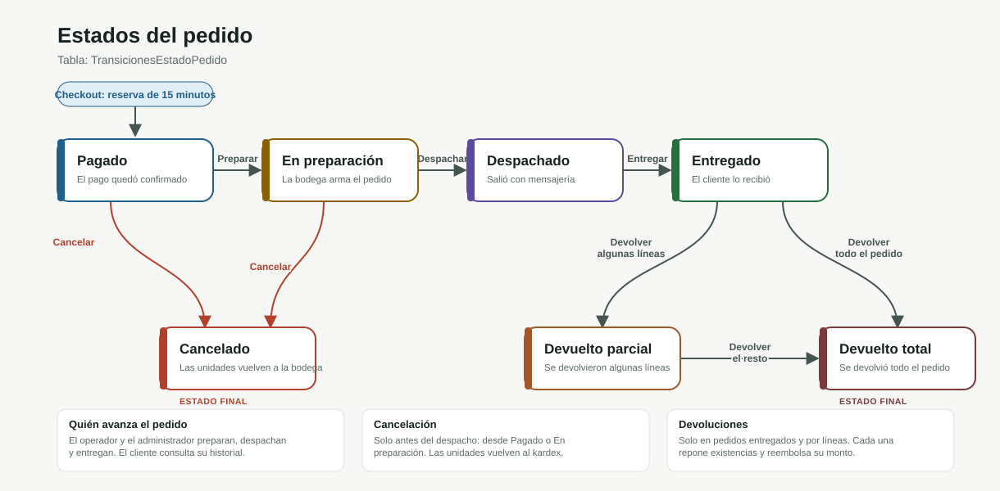

# Fase 1

# ShopCart Backend

API de comercio electrónico para gestionar catálogo, inventario, carritos, pedidos y usuarios. Está desarrollada con TypeScript, Express y SQL Server. El pago se simula; no hay integración con una pasarela de cobros.

## Tecnologías

| Parte | Tecnologías |
| --- | --- |
| Base de datos | SQL Server 2022 o posterior (Docker usa 2025), procedimientos almacenados, funciones, vistas y triggers |
| Backend | Node.js 24, TypeScript, Express 5, Zod, `mssql`, JWT, bcrypt, Helmet, express-rate-limit, ExcelJS, node-cron |
| Frontend | React 19, TypeScript, Vite, Tailwind CSS 4, TanStack Query, React Hook Form, Zustand, Recharts, PWA con `vite-plugin-pwa` |
| Imágenes | AWS S3 con URL firmada y CloudFront; la imagen se comprime en el navegador antes de subirla |
| Tiempo real | Server-Sent Events con ticket de un solo uso |
| Escalado | Redis (eventos, caché, tickets, límite de intentos, candados), Nginx y dos réplicas de la API |
| Observabilidad | Prometheus, Grafana, `prom-client` y `X-Request-Id` |
| Entorno | Docker Compose, GitHub Actions |
| Pruebas | Ejecutor de pruebas de Node.js, pruebas HTTP de integración y concurrencia contra SQL Server, Playwright |

## Arquitectura

Arquitectura Vertical Slice, con DDD y CQRS ligeros.

**Vertical.** El código se organiza por funcionalidad . Cada módulo de `features/` es un slice completo: controlladores: rutas, servicios:  comandos, consultas, acceso a datos: modelos, repositorio y reglas de dominio. Lo demas: configuración, middlewares, errores de dominio está en `core/`.

**CQRS ligero.** Las escrituras son Commands y las lecturas son Queries, cada una con su handler. Comparten la misma base de datos, sin sistema de  mensajes ni BD separada por cuestion de tiempo. La ruta valida la entrada con Zod y delega en el handler, el repositorio solo invoca procedimientos almacenados.

**DDD ligero.** Las reglas del negocio viven en `domain/` como código: estados del pedido, las políticas de cupones e inventario, el objeto de valor  y los errores de dominio. La persistencia, las transacciones y el control de existencias se resuelven en SQL Server.



### Por qué esta arquitectura

- Slices verticales: Se seleccionó esta arquitectura porque permite organizar el código en función de lo que la aplicación hace. Este modelo agrupa todos los componentes necesarios para resolver una función específica. Esto reduce el tiempo de desarrollo y facilita la búsqueda de archivos.
- CQRS ligero: Se complementó el diseño con un enfoque de CQRS ligero para separar las operaciones de lectura y escritura dentro de cada función.
- DDD ligero: las reglas base viven en `domain/` (transiciones de estado, políticas de cupones e inventario). 


## Desarrollo local

El backend está en `shop-cart-backend/`. 

Se necesita Node.js 24  y  SQL Server. La configuración de conexión se toma de `.env`.

Desde la raíz del repositorio:

```sh
cd shop-cart-backend
npm ci
```

Crear `.env` a partir de [`.env.example`](shop-cart-backend/.env.example).

Completar las credenciales de SQL Server y los secretos de JWT antes de iniciar la aplicación.

Para SQL Server con Docker, crear el `.env` de la raíz a partir de [`.env.example`](.env.example). `MSSQL_SA_PASSWORD` debe tener el mismo valor que `DB_PASSWORD` del `.env` del backend. `docker compose up -d mssql-server` levanta solo SQL Server.

| Variable | Uso |
| --- | --- |
| `PORT` | Puerto HTTP; por defecto, `3000`. |
| `NODE_ENV` | Entorno: `development`, `test` o `production`. |
| `RESERVATION_TTL_MINUTES` | Minutos durante los que se apartan los productos al pasar al pago. |
| `DB_HOST`, `DB_PORT` | Dirección y puerto de SQL Server. |
| `DB_ENCRYPT` | `true` para Azure SQL (conexión cifrada); `false` por defecto para SQL Server local. |
| `DB_ENCRYPT` | `true` para Azure SQL (conexión cifrada); `false` por defecto para SQL Server local. |
| `DB_USER`, `DB_PASSWORD` | Credenciales de conexión. |
| `DB_NAME` | Nombre de la base de datos. |
| `JWT_ACCESS_SECRET`, `JWT_REFRESH_SECRET` | Secretos de autenticación. |
| `JWT_ACCESS_EXPIRES_IN_MIN` | Duración del token de acceso; por defecto, `15m`. |
| `JWT_REFRESH_EXPIRES_IN_DAYS` | Duración del refresh token en días; por defecto, `7`. |
| `JWT_FAMILY_EXPIRES_IN_DAYS` | Duración máxima de la familia de sesiones en días; por defecto, `30`. |
| `RATE_LIMIT_AUTH_MAX` | Intentos de autenticación permitidos por ventana; por defecto, `15`. |
| `RATE_LIMIT_AUTH_WINDOW_MIN` | Ventana de autenticación en minutos; por defecto, `15`. |
| `CORS_ALLOW_ORIGIN` | Origen permitido para el frontend, `http://localhost:5173`. |
| `S3_BUCKET`, `S3_REGION` | Bucket y región de AWS S3 donde se suben las imágenes de productos; opcionales. |
| `CDN_BASE_URL` | URL base de CloudFront desde donde se sirven las imágenes, por ejemplo `https://dxxxx.cloudfront.net`; opcional. |
| `AWS_ACCESS_KEY_ID`, `AWS_SECRET_ACCESS_KEY` | Credenciales de AWS; si no se definen, se usa la cadena de credenciales por defecto del SDK. |
| `REDIS_URL` | URL de Redis, por ejemplo `redis://localhost:6379`; opcional. Sin ella, el estado compartido queda en memoria del proceso. |
| `TYPESAFE_API_KEY` | Clave del proveedor de IA para las recomendaciones; opcional; sin clave se usa el orden local. |
| `JEV_MODEL` | Modelo de IA; opcional; sin clave se usa el orden local. Por defecto, `jev-latest`. |
| `JEV_TIMEOUT_MS` | Tiempo máximo de espera de la IA en milisegundos; opcional; sin clave se usa el orden local. Por defecto, `2000`. |
| `JEV_URL` | URL del servicio de IA; opcional; sin clave se usa el orden local. |
| `INSTANCE_ID` | Nombre de la instancia que se devuelve en el encabezado `X-Instancia`; por defecto, el hostname. |
| `GRAFANA_ADMIN_PASSWORD` | Contraseña del administrador de Grafana; va en el `.env` de la raíz, junto a `MSSQL_SA_PASSWORD`. |
| `TRUST_PROXY` | Número de proxies delante de la API (`1` con Nginx del compose, `2` si además hay un Nginx con certificado en el servidor), para que el límite de intentos use la IP del cliente; opcional. |

### Base de datos

Con SQL Server disponible y `.env` configurado, ejecutar desde `shop-cart-backend/`:

```sh
npm run db:setup
```

El inicializador crea la base indicada en `DB_NAME` si no existe, crea las tablas cuando la base no tiene tablas de usuario y aplica funciones, vistas, procedimientos, datos de ejemplo. El usuario de conexión necesita permisos para estas operaciones.

Los archivos SQL están en [`scrips/`](shop-cart-backend/scrips/), numerados según su orden de ejecución:

1. [`01_tablas_y_semilla_base.sql`](shop-cart-backend/scrips/01_tablas_y_semilla_base.sql): tablas y datos base.
2. [`02_funciones.sql`](shop-cart-backend/scrips/02_funciones.sql): funciones de inventario y descuentos.
3. [`03_vistas.sql`](shop-cart-backend/scrips/03_vistas.sql): consultas agregadas de pedidos y ventas.
4. [`04_stored_procedures.sql`](shop-cart-backend/scrips/04_stored_procedures.sql): operaciones del negocio.
5. [`05_seed_datos_demo.sql`](shop-cart-backend/scrips/05_seed_datos_demo.sql): datos de ejemplo.

`db:setup` es un inicializador, no un sistema de migraciones

### Servidor

```sh
npm run dev
```

La API queda disponible en `http://localhost:3000/api/v1`. El puerto depende de `PORT`.

- Estado del proceso: [`GET /health`](http://localhost:3000/health).
- Referencia de la API: [`/api/docs`](http://localhost:3000/api/docs).
- Especificación OpenAPI: [`/api/openapi.json`](http://localhost:3000/api/openapi.json).

`/health` informa que el proceso responde; no comprueba la conexión a SQL Server. [`/health/listo`](http://localhost:3000/health/listo) sí comprueba SQL Server y, si está configurado, Redis.

### Docker completo

El `docker-compose.yml` también levanta Redis, dos réplicas de la API y Nginx con la interfaz. Estos servicios, junto con SQL Server local, están en el perfil `app`; `docker compose up -d mssql-server` sigue levantando solo la base de datos para desarrollo con `npm run dev`.

Lee las variables del `.env` de la raíz. Compose cambia `DB_HOST`, `REDIS_URL` y `CORS_ALLOW_ORIGIN` para la red interna.

```sh
docker compose --profile app up -d --build
```

La aplicación queda en `http://localhost:8080`. El encabezado `X-Instancia` indica qué réplica respondió. Para apagar todo: `docker compose --profile app down`.

Puertos del host: 8080 web, 1433 SQL Server, 9090 Prometheus y 3002 Grafana. `GRAFANA_ADMIN_PASSWORD` es obligatoria en el `.env` de la raíz. Los puertos se pueden cambiar con `WEB_PORT`, `MSSQL_PORT`, `PROMETHEUS_PORT` y `GRAFANA_PORT`.


### Producción con Azure SQL

El perfil `prod` no levanta SQL Server: usa una base en Azure SQL y las imágenes publicadas.

1. Crear `.env.prod` en la raíz copiando las variables del `.env`, con `DB_HOST=<servidor>.database.windows.net`, `DB_USER`, `DB_PASSWORD`, `DB_NAME` y `DB_ENCRYPT=true`. El archivo no se sube a git.
2. Permitir en el firewall de Azure SQL la IP del servidor.
3. En el `.env` de la raíz definir `CORS_ALLOW_ORIGIN=https://tu-dominio` y `GRAFANA_ADMIN_PASSWORD`.
4. `docker compose --profile prod up -d`.

Mientras pruebas, la aplicación queda en `http://IP-DEL-SERVIDOR:8080`. Con certificado, poner `WEB_BIND=127.0.0.1` y `TRUST_PROXY=2` en el `.env` para que `web` solo escuche en local. El certificado va en el Nginx del servidor, que hace `proxy_pass http://127.0.0.1:8080` con `proxy_buffering off` y `proxy_read_timeout 1h` para el SSE del dashboard.

### Observabilidad

Con `docker compose --profile app up -d --build` también arrancan Prometheus y Grafana.

- Grafana: `http://localhost:3002`, dashboard "ShopCart" con acceso anónimo de solo lectura. El usuario `admin` usa `GRAFANA_ADMIN_PASSWORD`.
- Prometheus: `http://localhost:9090`. Lee `/metrics` de `api-1` y `api-2` cada 15 segundos.
- `/metrics` no se publica por Nginx; solo se llega desde la red de Docker.

Paneles del dashboard:

- Peticiones por segundo, latencia p50 y p95 por instancia, y porcentaje de errores 5xx (0 si no hay errores).
- Checkout por resultado y confirmados en la última hora.
- Intentos de pago por estado en la última hora.
- Clientes SSE conectados por instancia.
- Los 10 procedimientos almacenados más lentos (p95).
- Memoria y retraso del event loop por instancia.

Cada respuesta lleva `X-Request-Id`; si el cliente lo envía, se respeta. Los errores del servidor lo incluyen en el log.


## Organización del código

```text
shop-cart-backend/
├── scrips/                 Scripts de SQL Server
├── src/
│   ├── core/
│   │   ├── config/         Entorno, conexión e inicialización de la base
│   │   ├── cqrs/           Contratos de comandos y consultas
│   │   ├── domain/         Errores y manejo de importes
│   │   ├── http/           OpenAPI y gestión 
│   │   └── middlewares/    Autenticación, validación y errores
│   ├── features/           Módulos del negocio y registro de rutas
│   └── server.ts           Entrada HTTP y limpieza de reservas
└── tests/                  Pruebas de dominio, integración y concurrencia
```

Cada módulo tiene rutas, modelos, comandos, consultas y repositorio. Los Command representan operaciones de escritura; las Queries lecturas. Los contratos de repositorio están en `abstracts/` y las implementaciones en `repository/`.

Los repositorios acceden a SQL Server mediante procedimientos almacenados. Las transacciones y el control de existencias se resuelven en la base de datos. El inicializador de la base ejecuta los scripts SQL directamente.

El registro en [`src/features/index.ts`](shop-cart-backend/src/features/index.ts) busca archivos `*.routes.ts` o `*.routes.js` y monta cada router bajo `/api/v1/<nombre>`.

| Módulo | Responsabilidad |
| --- | --- |
| `auth` | Registro, inicio y cierre de sesión, renovación de tokens, perfil, usuarios y roles. |
| `catalogo` | Categorías, productos, variantes, precios e imágenes. |
| `inventario` | Kardex, movimientos y consulta de existencias bajas. |
| `carrito` | Artículos del carrito de clientes e invitados. |
| `cupones` | Creación, aplicación y retiro de descuentos. |
| `checkout` | Direcciones, reserva de existencias y confirmación de pedidos. |
| `pedidos` | Historial, cambios de estado y devoluciones. |
| `favoritos` | Productos guardados por cada cliente. |
| `dashboard` | Métricas, exportación a Excel y actualizaciones por SSE. |
| `bitacora` | Consulta de auditoría. |
| `seed` | Carga de datos de ejemplo en desarrollo. |

Los contratos de las peticiones y respuestas estan en OpenAPI.


## Modelo de datos



La base tiene 31 tablas en seis áreas: acceso y auditoría, catálogo, inventario, carrito y cupones, pedidos, y envío. Las llaves primarias siguen el formato `IDProducto` y todo el acceso a datos pasa por procedimientos almacenados. Los montos usan `DECIMAL`.

## Estados del pedido



Un pedido nace en `PAGADO` cuando el checkout confirma el pago y avanza hasta `ENTREGADO`. Se puede cancelar antes del despacho y devolver después de la entrega. Las transiciones válidas están en la tabla `TransicionesEstadoPedido`; el procedimiento almacenado rechaza cualquier otra.

## Acceso y datos de ejemplo

El seed crea estas cuentas en una instalación nueva:

| Rol | Correo | Contraseña inicial |
| --- | --- | --- |
| Administrador | `admin@shopcart.gt` | `Admin123!` |
| Operador | `operador@shopcart.gt` | `Admin123!` |
| Cliente | `cliente@shopcart.gt` | `Admin123!` |


El administrador gestiona catálogo, usuarios, cupones y reportes. El operador trabaja con inventario, preparación de pedidos y devoluciones. El cliente accede a sus propios carritos, direcciones, favoritos y pedidos.


## Cumplimiento del reto

| Requisito | Cómo se resuelve | Dónde se prueba |
| --- | --- | --- |
| RF-01 Acceso | Hash bcrypt, access token de 15 min y refresh token con rotación. Cada SP valida que el carrito, la dirección o el pedido sean del usuario; si no, responde 403 o 404. | `audit-regression.test.ts` (IDOR, usuario desactivado) |
| RF-02 Catálogo | Variantes con SKU único. El detalle del pedido guarda `PrecioUnitarioCongelado`, así que cambiar el precio no toca pedidos viejos. Un producto con ventas se desactiva, no se borra. | `domain.test.ts`, `extensiones.test.ts` |
| RF-03 Inventario | Todo cambio pasa por el kardex con usuario, motivo y saldo. Un ajuste sin motivo o que deja la existencia en negativo se rechaza (50030, 50033). | `concurrencia-extra.test.cjs` compara existencia contra la suma del kardex |
| RF-04 Carrito | No deja agregar más de lo disponible (50040). Los montos son `DECIMAL` y el total se calcula en SQL. | `domain.test.ts` (Money) |
| RF-05 Cupones | Porcentaje o monto fijo, por carrito o por categoría, un cupón por pedido. Cada rechazo tiene su código: vencido, agotado, inactivo, mínimo o límite por cliente. El total nunca baja de cero. | `real-concurrency.test.cjs` (último uso), `concurrencia-extra.test.cjs` (3 usos, 10 clientes) |
| RF-06 Checkout | Reserva de 15 min. `SP_Pedidos_CrearPedido` bloquea con `UPDLOCK, HOLDLOCK` y guarda pedido, detalle, kardex y cupón en una transacción. La clave de idempotencia evita pedidos y cobros dobles. | `real-concurrency.test.cjs` (última unidad, 5 confirmaciones iguales, rollback), `pagos.test.ts` |
| RF-07 Pedidos | Transiciones en `TransicionesEstadoPedido` y en `order-state.machine.ts`. Cancelar o devolver repone por kardex. No se devuelve más de lo vendido (50082). La reserva vencida se libera sola cada minuto y ya no se puede pagar (50112). | `domain.test.ts`, `concurrencia-extra.test.cjs` |
| RF-08 Reportes | Ventas por día, semana y mes, por categoría y top 10. Solo cuentan pedidos entregados y se restan devoluciones. Listados paginados y filtrados en el servidor. | `extensiones.test.ts`, `audit-regression.test.ts` (caché) |
| RF-09 Bitácora | Se escribe dentro de cada SP. El trigger `TR_Bitacora_Inmutable` (`INSTEAD OF UPDATE, DELETE`) impide cambiarla. | Revisión del script 01 |
| Sin SQL en el backend | Solo se llaman procedimientos `SP_Modulo_Proceso`. Las únicas excepciones son el seed y el inicializador. | `sin-sql.test.ts` revisa todo `src/` y la nomenclatura de los scripts |

Extras del reto: dashboard en vivo con SSE, exportación a Excel, caché del resumen con invalidación y límite de intentos en autenticación.

## Decisiones 

 Esto es lo que se decidió.

- Se agrego mas funcionalidades ademas de los requerimientos del reto demostrar la extensibilidad del diseño, comprobando que la estructura elegida permite añadir nuevas características.
- El flujo principal de un pedido es `PAGADO → EN_PREPARACION → DESPACHADO → ENTREGADO`.
- Renovación de sesión: se tolera durante 10 segundos el reuso de un refresh token recién rotado 
- Token inválido: en carrito y checkout responde 401, para no tratar como invitado a un cliente con la sesión vencida y perderle el carrito. Solo el catálogo lo toma como invitado
- Un pedido ajeno responde 404, igual que uno inexistente, para no confirmar que existe.
- El checkout no crea el pedido hasta confirmar el pago, y la reserva de existencias dura 15 minutos.
- El pago se simula
- El cobro se autoriza antes de crear el pedido y se captura después. Si el pedido falla, el cobro se anula. Lo que queda a medias lo revisa la conciliación cada minuto.
- La contraseña exige entre 8 y 72 caracteres. 
- El dashboard en vivo usa un ticket de un solo uso con 30 segundos.
- Con varias réplicas, Redis comparte los tickets del dashboard, el caché del resumen, el límite de intentos, los eventos en vivo y el candado de las tareas programadas. Si Redis se cae, el catálogo y el checkout siguen funcionando porque SQL Server protege el stock y la idempotencia; los eventos solo llegan a los clientes de la misma réplica, el límite de intentos no se aplica y el ticket del dashboard no se puede emitir.
- El ordenamiento se hace en el servidor .
- La primera dirección activa de un cliente queda como predeterminada
- Las Estadisticas cuentan como completados los pedidos entregados y descuentan las devoluciones. 
- Las imágenes se optimizan en el navegador y se suben directo a S3 con una URL firmada. La base guarda la llave del archivo, no la URL; la URL de la CDN se arma al leer con `CDN_BASE_URL`. Al cambiar la portada o borrar un producto, el archivo viejo se borra del bucket.
- La IA solo recibe nombres de productos, categorías, precios y el texto de búsqueda, nunca ids de usuario ni correos, y tiene un presupuesto de 30 llamadas por minuto compartido entre réplicas.


## Pruebas

Desde `shop-cart-backend/`:

```sh
npm run typecheck
npm test
```

`typecheck` comprueba los tipos. `npm test` ejecuta las pruebas de dominio, esquemas y extensiones con el ejecutor de pruebas de Node.js. También corre `sin-sql.test.ts`, que falla si aparece SQL fuera de los procedimientos.

Las pruebas de integración y concurrencia HTTP necesitan una API local conectada a una base de pruebas cuyo nombre comience por `ShopCartAudit_`. Crean registros de prueba y los conservan para inspección.

Para preparar ese entorno, hay que  configurar `DB_NAME` con otra base de datos para test, `PORT=3107` `RATE_LIMIT_AUTH_MAX=500` las suites registran muchos usuarios y `RESERVATION_TTL_MINUTES=1` porque la suite extra de concurrencia espera a que venza una reserva, ejecutar `npm run db:setup` e iniciar la API. 

```powershell
$env:RUN_AUDIT_INTEGRATION = '1'
$env:AUDIT_DB_NAME = 'ShopCartAudit_local'
$env:AUDIT_API_URL = 'http://localhost:3107/api/v1'
npm run test:integration
npm run test:concurrency:http
```

`AUDIT_DB_NAME` debe coincidir con el `DB_NAME` de la API de pruebas. Estas suites modifican datos y deben ejecutarse en la base aislada.

`test:concurrency:http` cubre la última unidad, confirmaciones repetidas, el último uso de un cupón, un cupón de 3 usos contra 10 clientes, la reserva vencida, la misma clave usada por otro cliente y el cuadre de existencia contra kardex.

### Rendimiento

`npm run test:rendimiento` mide cada listado 20 veces, después de 3 de calentamiento, contra la API de pruebas. Resultado con los datos de ejemplo, en un i7-1165G7 con 16 GB:

| Endpoint | p50 (ms) | p95 (ms) |
| --- | --- | --- |
| Catálogo | 27.8 | 41.5 |
| Catálogo con filtros y orden | 31.1 | 39.1 |
| Detalle de producto | 15.7 | 22.6 |
| Carrito | 16.9 | 31.1 |
| Mis pedidos | 24.1 | 35.8 |
| Pedidos (admin) con filtros | 15.7 | 19.3 |
| Kardex | 32.7 | 39.0 |
| Existencias bajas | 15.7 | 17.5 |
| Cupones | 15.4 | 25.6 |
| Usuarios | 15.8 | 24.2 |
| Bitácora | 15.3 | 31.3 |
| Resumen del dashboard, sin caché | 15.8 | 68.6 |
| Resumen del dashboard, con caché | 15.7 | 18.2 |
| Exportación a Excel | 32.2 | 51.6 |

Todo queda por debajo de 1 segundo. Se midió con los datos de ejemplo (82 productos, 22 pedidos, 171 movimientos de kardex), así que sirve para ver que no hay consultas pesadas, no como prueba de carga.

`npm run test:concurrency` ejecuta una demostración adicional de concurrencia. Su implementación está en [`tests/concurrency-demo.ts`](shop-cart-backend/tests/concurrency-demo.ts).

## Licencia

MIT. Ver [`LICENSE`](LICENSE). El código es de Edwin Baquiax.
